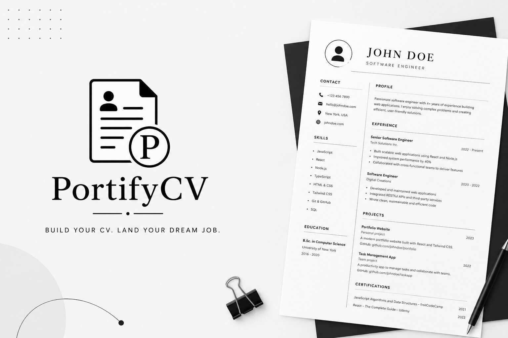

# PortifyCV

[](https://github.com/R0uty/PortifyCV/actions/workflows/ci.yml)



A modern, minimal CV builder for creating and exporting professional resumes in real-time.

## Features

- **Live Preview**: See your CV update instantly as you edit
- **Direct Edit**: Edit the CV right on the preview — click any text to change it,
  add/remove/reorder entries, upload a photo, and move sections between the main
  column and the sidebar; the same section nav rail as the form editor jumps to
  any section and opens its editor, and the entry being edited is highlighted;
  the classic form editor is one toggle away
- **18 Templates**: Minimalist, Developer, Creative, Modern Professional, Executive,
  Modern Timeline, Graduate, Compact, Portfolio Hybrid, Tech Executive, Classic
  Professional, Navy Professional, Modern Orange, Colorful Compact, Quadrant,
  Editorial, Portrait, and European — each template supports its own set of CV
  sections, and the editor only shows what the selected template actually renders.
  Every template has its own page (`/free-cv-templates/<slug>`) showing it filled
  with example CVs, reachable from the builder's template gallery ("View
  examples") and the Free CV Templates page
- **ATS Optimization**: Parser-readiness score, job-description keyword matching, and a
  dedicated ATS-friendly mode that flattens any template for applicant tracking systems
- **CV Suggestions**: Rule-based feedback on clarity, impact, and completeness
- **Export**: PDF (rendered, with a text-based fallback), Word (.docx), standalone HTML, and JSON
- **Share & Import**: Generate a shareable link that carries the CV text in the URL,
  or import a JSON backup / paste raw resume text
- **Bilingual UI**: English and Finnish
- **No persistence**: No CV data is saved to a server or to browser storage; the CV lives
  in the page for as long as the tab is open. Local storage only holds UI preferences
  (language, editor mode, onboarding dismissed). If you turn on "restore last
  session" in Settings, a snapshot is kept in session storage, so it survives a
  reload but is gone once the tab is closed.

## Tech Stack

- **React 19**: UI framework with hooks
- **Vite 8**: Build tool with HMR
- **Hand-written utility CSS**: `src/index.css` imports a Tailwind-alike utility
  layer (`px-4`, `flex`, `text-xs`, ...) written by hand — there is no Tailwind
  build step or dependency in this project. The styles live in `src/styles/`:
  `tokens.css` (design tokens + reset), `app-shell.css` (shared chrome),
  `utilities.css` (the atomic class layer), and `templates/*.css` (one file per
  bespoke template Showcase)
- **@fontsource-variable/inter**: Self-hosted variable-weight Inter, so the only
  network requests the app makes are for its own same-origin assets
- **lucide-react**: Icon set used throughout the toolbar, nav rail, and editor
- **html2canvas**: PDF design rendering
- **jsPDF**: PDF generation (page assembly runs in a Web Worker)
- **@dnd-kit**: Drag-and-drop reordering of CV entries
- **ESLint**: Code quality checks

## Development

```bash
# Install dependencies
npm install

# Start dev server (with HMR)
npm run dev

# Build for production
npm run build

# Preview production build
npm run preview

# Run linter
npm run lint

# Verify the share-link codec (no browser needed)
npm run check:share

# Verify the form/UI reducers (no browser needed)
npm run check:reducers

# Verify the rule-based CV feedback engine (no browser needed)
npm run check:feedback

# Verify the Word (.docx) export builders (no browser needed)
npm run check:docx-export

# Verify the Direct Edit section schema (no browser needed)
npm run check:section-schema

# Verify the section column-move rules (no browser needed)
npm run check:section-columns

# Verify the per-template page slugs, examples, and copy (no browser needed)
npm run check:template-pages

# Run the end-to-end smoke suite against a production build
npm run test:e2e

# Same suite minus the slow stress/PDF tier — what CI's main e2e job runs
npm run test:e2e:fast

# Only the slow stress/PDF tier — a separate CI job
npm run test:e2e:slow
```

`check:share` round-trips a full CV through the share-link encoder and decoder.
Run it after touching `src/utils/shareLinks.js` or the CV schema in
`src/utils/cvForm.js` — a mistyped short key silently drops a field from every
link the app generates.

`check:reducers` covers every action `cvFormReducer` and `uiReducer` handle —
field updates, array-item add/remove/duplicate/move, section reordering,
merge/reset/import, and unknown-action no-ops.

`check:feedback` covers `evaluateCvFeedback` (`src/utils/cvFeedback.js`) —
missing/thin sections, over-length copy, weak-phrase detection ("responsible
for", "in charge of", ...), and action-verb-opener detection across an
experience entry's description and achievement bullets.

`check:docx-export` covers the Word exporter and its layout archetypes
(`src/utils/docxExport.js`), `check:section-schema` validates the Direct Edit
popup's section schema (`src/utils/sectionSchema.js`), and
`check:section-columns` covers which sections may move between the main
column and the sidebar, and how imports validate that.

`check:template-pages` validates the per-template pages
(`/free-cv-templates/<slug>`): every template has a unique kebab-case slug
and 2–3 examples, every example loads and round-trips through
`parseImportedCvData` in both locales with a fictional `@example.com`
email, every example fills every primary section of each template it's
listed under, every template has a 3-tip, bilingual `templatePageCopy`
entry and a 50–160 character English `metaDescription` (in the separate
`templateMetaDescriptions.js`), and every slug appears in
`public/sitemap.xml`. All seven scripts are framework-free Node
harnesses, no test runner required; CI runs them all on every push and
pull request.

`test:e2e` runs the Playwright suite in `e2e/` (landing page, live preview,
template-gated sections, the Export menu, the per-template layout/content
harness, PDF export) against `npm run build` + `npm run preview`, not the
dev server, so it exercises the app the way a real user gets it — lazy
chunks, manual vendor chunking, and all. Downloads and installs a Chromium
build the first time it runs (`npx playwright install chromium`).
`test:e2e:fast`/`test:e2e:slow` run a subset by Playwright tag
(`--grep-invert @slow`/`--grep @slow`): the slow tier is the layout
harness's stress-fixture tests plus `template-pdf.spec.js` and
`template-pdf-placeholder.spec.js`, which together roughly double full-suite
time; CI runs them as a separate `e2e-slow` job so the main `e2e` job stays
fast.

## Production Build

The production build outputs to `/dist/`:

```bash
npm run build
```

Static files are ready to be served:
- `dist/index.html` - Main entry point
- `dist/assets/` - JS and CSS bundles
- `dist/logo-mark.png` - Site icon (favicon and apple-touch-icon)
- `dist/PortifyCV.jpg` / `dist/PortifyCV2.jpg` - Brand and marketing images
  (landing page header, `og:image`/`twitter:image`, this README)

## Deployment

Production runs on Cloudflare Workers (`wrangler.jsonc`, `worker/index.js`
serving `dist/` as static assets):

```bash
npm run build
npm run deploy        # wrangler deploy
npm run worker:dev    # run the Worker locally
```

The `dist/` folder also works on any other static host:

```bash
# GitHub Pages
npm run build
# Push dist/ to gh-pages branch

# Vercel/Netlify
npm run build
# Connect your repository and auto-deploy from main

# Traditional server
npm run build
scp -r dist/* user@server:/var/www/portifycv/
```

### Security response headers

`X-Frame-Options` and `X-Content-Type-Options` only take effect as real HTTP
response headers — browsers ignore them entirely when set via a `<meta>` tag
(Chrome logs a console error and drops it), so they can't live in
`index.html`. This repo ships the equivalent for hosts that support custom
headers:

- **Netlify** reads [`public/_headers`](public/_headers) automatically.
- **Vercel** reads [`vercel.json`](vercel.json) automatically.
- **GitHub Pages** has no custom-header mechanism at all — this protection
  isn't available on that host.
- **Traditional server**: add the same three headers (see either file above)
  in your nginx/Apache/Caddy config.

`vite.config.js`'s `server.headers`/`preview.headers` set the same headers
for `npm run dev` and `npm run preview`, but that's local-only — it doesn't
reach a real deployment.

### SPA routing fallback

PortifyCV has no server, so client-side routes like `/cv` and `/privacy`
only resolve if the host serves `index.html` for any path that isn't a real
static file. Without this, a direct visit, a page refresh, or a crawler
fetching one of those URLs gets a 404 instead of the app.

- **Cloudflare Workers** (the live production host) runs
  [`worker/index.js`](worker/index.js) in front of the static assets
  (wired up via `main` + `assets.binding` in
  [`wrangler.jsonc`](wrangler.jsonc)). The worker matches the request path
  against `src/utils/routes.js`/`pageMeta.js` itself and serves
  `dist/index.html` for known routes, rewriting each route's own
  title/canonical/description/OG/structured-data into the response at the
  edge — so a crawler that never runs JS still sees the right metadata for
  `/cv`, `/privacy`, etc., not the homepage's. Unknown paths get a real
  `404` (with `noindex`) instead of a 200. Don't add a `public/_redirects`
  catch-all here — on Workers static assets a `/* /index.html 200` rule
  intercepts every request, including real files, before the asset lookup
  runs, which breaks CSS/JS/image serving entirely (confirmed in
  production: every path returned `index.html`'s content, even for
  existing static files).
- **Netlify** reads a `public/_redirects` file with `/*    /index.html   200`
  automatically (not shipped here since it isn't the live host — add it
  back if you deploy to Netlify).
- **Vercel** reads the `rewrites` block in [`vercel.json`](vercel.json)
  automatically.
- **GitHub Pages** has no rewrite mechanism, but `npm run build` already
  copies `dist/index.html` to `dist/404.html` — GitHub Pages serves
  `404.html` for any unmatched path, so `/cv` and `/privacy` resolve there
  too without extra setup.
- **Traditional server**: add an equivalent try-files/fallback rule in your
  nginx/Apache/Caddy config.

## Google SEO Setup

After deployment, complete Google indexing and performance monitoring:

1. Open Google Search Console and add your production domain.
2. Verify ownership with your preferred method (DNS TXT is recommended).
3. Submit `https://your-domain/sitemap.xml`.
4. Use Search Console "Page indexing" and "Core Web Vitals" reports to track visibility and performance.

If your live domain is not `https://portifycv.app`, update canonical/OG URLs in `index.html`, the `SITE_ORIGIN` constant in `src/utils/pageMeta.js` (read by both `src/App.jsx` and `worker/index.js`), and the domain in `public/sitemap.xml` and `public/robots.txt`.

### AdSense

Google AdSense is wired in: the `adsbygoogle.js` snippet
(publisher `ca-pub-4696294951019088`) loads in `index.html`'s `<head>` on
every route, and `public/ads.txt` carries the publisher line. EEA/UK/CH
consent is Google's certified GDPR message, enabled in the AdSense
dashboard under **Privacy & messaging** — not app code. Privacy policy and
`/about` disclose the ad cookies. See
[`docs/adsense-indexing-readiness.md`](docs/adsense-indexing-readiness.md)
for the history and the remaining dashboard-side steps.

## Performance

- The PDF dependencies (html2canvas + jsPDF) dominate the bundle and are loaded lazily,
  only when an export is triggered
- Gzipped CSS: ~23KB; initial gzipped JS: ~75KB
- Page-sliced PDF rendering for large multi-page CVs
- Adaptive rendering scale to prevent memory overflow

## Routes

- `/` — landing page
- `/cv` — opens the builder directly
- `/about` — about + contact
- `/privacy` — privacy policy
- `/free-cv-templates/<slug>` — a public page per template (18 slugs,
  e.g. `/free-cv-templates/developer`), showing it filled with 2–3
  switchable example CVs and a link into the builder with that template
  and example preloaded
- guide/content pages (`/free-cv-templates`, `/how-to-write-a-cv`, `/cv-examples`, …) — see `src/utils/routes.js` for the full list
- `#data=<payload>` — restores a CV from a share link (works on any route)

Share links carry the CV in the URL fragment, so it is never sent to a server. Uploaded
images (profile photo, project images) are left out of the link — a single photo is many
times larger than a URL can hold — so the recipient sees the CV without them. Export JSON
when the images need to travel too.

## Browser Support

Modern browsers (Chrome, Firefox, Safari, Edge) with ES2020+ support.

## Project Documentation

- [`changes.md`](changes.md) — running change log
- [`docs/audit-1.0.0.md`](docs/audit-1.0.0.md) — the 1.0.0 pre-release audit: what
  was checked, what was fixed, and which behaviours are deliberate
- [`docs/audit-1.0.1.md`](docs/audit-1.0.1.md) — the 1.0.1 pass: template-gated
  sections, the nav rail sync fix, and the release-readiness verdict
- [`docs/audit-1.0.2.md`](docs/audit-1.0.2.md) — a fresh audit pass: a mobile
  toolbar overflow bug, Export menu keyboard accessibility, and non-functional
  security meta tags
- [`docs/security-audit-1.0.md`](docs/security-audit-1.0.md) — an adversarial
  penetration-test pass: XSS, prototype pollution, share-link tampering,
  URI-scheme injection, ReDoS, and the privacy claim, each tested with real
  payloads against the running app
- [`docs/adsense-indexing-readiness.md`](docs/adsense-indexing-readiness.md) —
  what's done for Google AdSense approval and indexing versus what still
  needs a real Google account and production domain

## License

Built as a portfolio CV builder.
